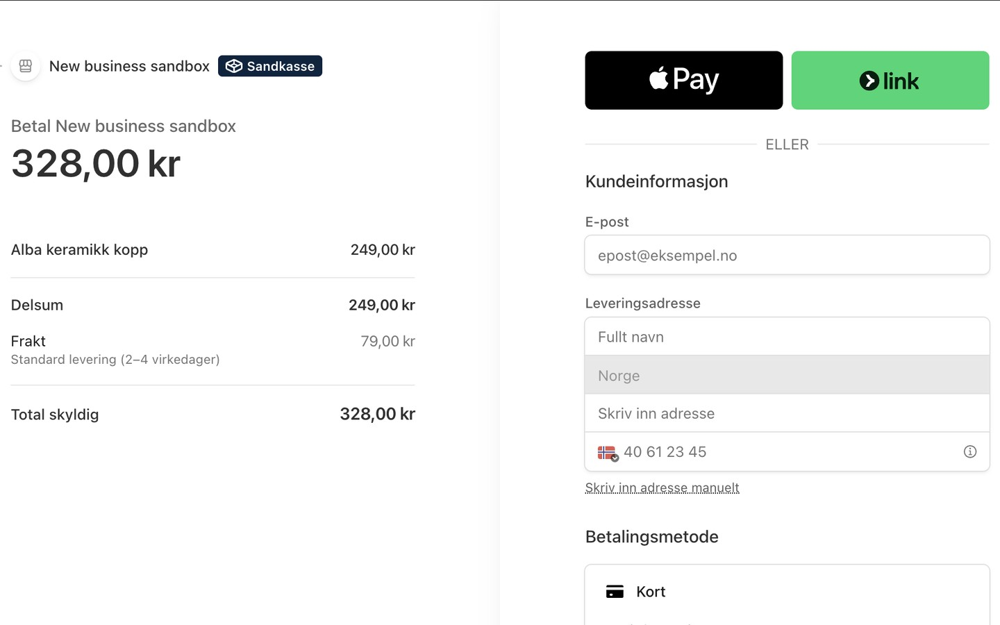

# Nordly

[](https://github.com/Khhashi/Nordly/actions/workflows/dotnet.yml)


Nordly er en portefølje- og testdemo bygget med .NET 8, Razor Pages, PostgreSQL og Stripe Checkout. Jeg bygde den for å lære lagdelt backend-arkitektur og teste hvordan én betaling kan gi nøyaktig én ordre.

**[Live demo ↗](https://ordermanager-8ym2.onrender.com)** | **[Arkitektur](docs/ARCHITECTURE.md)** | **[Tester](docs/TESTING.md)** | **[Utrulling](docs/DEPLOYMENT.md)**

Katalog, priser og tilbud er illustrative. Ingen varer selges eller sendes, og Checkout bruker bare Stripe testmodus. Ikke oppgi reelle person- eller kortopplysninger.

<sub>En gratis ping holder demoen vanligvis våken på hverdager kl. 06–21. Utenfor dette tidsrommet kan gratisplanen gi kaldstart.</sub>

## Grensesnitt

<table>
  <tr>
    <td width="50%"><br />Forside</td>
    <td width="50%"><br />Produktside</td>
  </tr>
  <tr>
    <td width="50%"><br />Handlekurv</td>
    <td width="50%"><br />Stripe Checkout</td>
  </tr>
</table>

## Funksjoner

**For alle**
- Se, søke i og filtrere produkter
- Handlekurv med antallsstyring, maks 10 per produkt
- Stripe Checkout i testmodus

**Med konto**
- Logge inn med engangskode på verifisert e-post
- Se egne ordre etter innlogging

**E-post og personvern**
- Ordrebekreftelser via Brevo eller konfigurert SMTP
- Nyhetsbrev med dokumentert samtykke og beskyttet avmelding
- Demodata slettes automatisk etter 30 dager

## Teknologi

**C#, .NET 8, Razor Pages · PostgreSQL (Neon), Entity Framework Core · Stripe · NUnit, Playwright · Docker, GitHub Actions, Render**

## Kjør lokalt

Krever .NET 8 SDK og Docker.

```bash
docker compose up -d
dotnet user-secrets set "ConnectionStrings:DefaultConnection" "Host=localhost;Port=5432;Database=nordly;Username=postgres;Password=postgres" --project Nordly.Web
dotnet tool install --global dotnet-ef --version 8.0.32
ConnectionStrings__DefaultConnection="Host=localhost;Port=5432;Database=nordly;Username=postgres;Password=postgres" dotnet ef database update --project Nordly.Infrastructure --startup-project Nordly.Web
dotnet run --project Nordly.Web
```

Legg hemmeligheter i User Secrets eller miljøvariabler, aldri i repoet. Betaling krever `Stripe:SecretKey` med `sk_test_`-nøkkel; webhook-test krever også `Stripe:WebhookSecret`. Appen avviser andre Stripe-nøkler, og begge verdiene er påkrevd utenfor Development. Brevo-nøkkel og avsender (`Email:BrevoApiKey`, `Email:FromAddress`) kreves for e-postinnlogging og nyhetsbrev.

## Sikkerhet og arkitektur

- **Betaling:** Signert Stripe-webhook og unik Checkout-ID hindrer doble ordre.
- **Konto:** Ordre vises bare til innlogget kunde med bekreftet e-postadresse.
- **Personvern:** Demoens konto-, ordre- og nyhetsbrevdata slettes etter 30 dager.
- **Drift:** Databeskyttelsesnøkler lagres i PostgreSQL og overlever omstarter.

Se [arkitekturdokumentet](docs/ARCHITECTURE.md) for systemdiagrammer, betalingsflyt og designvalg.

## Tester og CI

NUnit dekker domeneregler og integrasjon. Playwright med Chromium tester søk, filtrering, handlekurv og Checkout-retur. GitHub Actions kjører testene mot PostgreSQL og bygger Docker-imaget på pull requests. Se [testguiden](docs/TESTING.md) for oppsett.

## Ressurser

- **[Arkitektur](docs/ARCHITECTURE.md)** – lagdeling, flyter og datamodell
- **[Testguide](docs/TESTING.md)** – lokal kjøring og CI
- **[Utrulling](docs/DEPLOYMENT.md)** – migreringer og produksjonssetting
- **[Bildekilder](docs/IMAGE-SOURCES.md)** – lokale illustrasjoner og bildekilder
