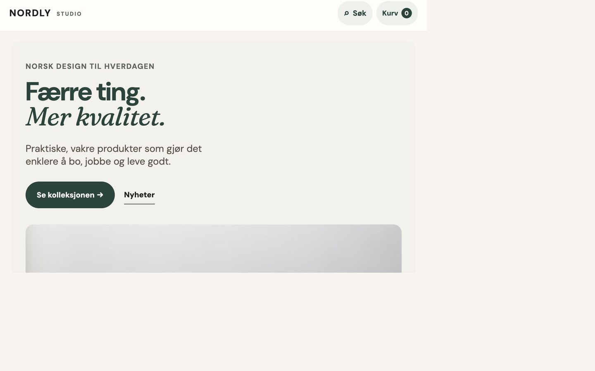
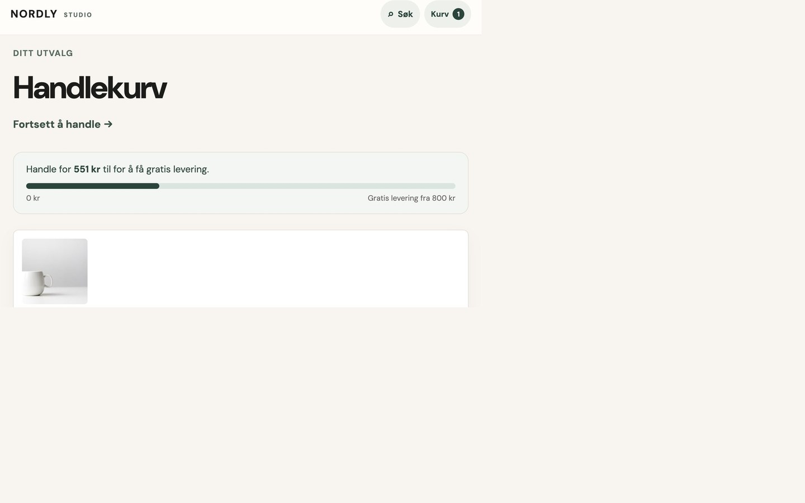

# Nordly

[](https://github.com/Khhashi/Nordly/actions/workflows/dotnet.yml)


Portefølje- og testdemo bygget i .NET 8 med Razor Pages, PostgreSQL og Stripe Checkout. Katalog, priser og tilbud er illustrative; ingen varer selges eller sendes, og Checkout bruker bare Stripe testmodus. Ikke oppgi reelle person- eller kortopplysninger.

**[Live demo ↗](https://ordermanager-8ym2.onrender.com)** | **[Arkitektur](docs/ARCHITECTURE.md)** | **[Testguide](docs/TESTING.md)**<br>
<sub>En gratis ping holder demoen vanligvis våken på hverdager kl. 06–21. Utenfor dette tidsrommet kan gratisplanen gi kaldstart.</sub>

## Hvorfor jeg bygde det

Jeg bygde Nordly for å bli bedre på backend, og på det som faktisk er vanskelig i en nettbutikk: at én betaling alltid gir nøyaktig én ordre, også når kunden lukker nettleseren underveis. Jeg valgte C# og .NET for å lære et typet backend-rammeverk med lagdelt arkitektur.

## Grensesnitt

Her er fire skjermbilder av grensesnittet, fra forsiden og produktsiden til handlekurven og Stripe Checkout.

<table>
  <tr>
    <td width="50%"></td>
    <td width="50%"></td>
  </tr>
  <tr>
    <td width="50%"></td>
    <td width="50%"></td>
  </tr>
</table>

## Funksjoner

- Produktkatalog med kategorifiltre og produktsider
- Handlekurv med antallsstyring (maks 10 per produkt)
- Passordfri kundekonto med verifisert e-post og oversikt over egne ordre
- Stripe Checkout med signert webhook for betalingsstatus
- Fraktvalg med gratis frakt fra 800 kr
- Ordrebekreftelse på e-post via Brevo sitt API
- Nyhetsbrev lagret i PostgreSQL med aktivt samtykke og avmelding via lenke i velkomst-e-posten

Kunden logger inn med en engangskode på e-post. Kontoen opprettes først når koden er bekreftet. Innloggede kunder ser ordre knyttet til den verifiserte e-postadressen sin; gjestekjøp krever ikke konto.
Demoens konto-, ordre- og nyhetsbrevdata slettes automatisk fra PostgreSQL etter 30 dager.

## Teknologi

**C#, .NET 8, Razor Pages · PostgreSQL (Neon), Entity Framework Core · Stripe · NUnit · Docker, GitHub Actions, Render**

## Tekniske valg og læring

- **Lagdelt arkitektur:** Løsningen er delt i egne prosjekter for web, domene, infrastruktur og tester. Domenet er uavhengig av web og database, så forretningsreglene kan testes isolert.
- **Betaling bekreftes av Stripe:** Ordren opprettes først når Stripe bekrefter betalingen, enten via en signert webhook eller når bekreftelsessiden henter økten fra Stripe. Begge veier bruker samme kode, og en unik Stripe-økt-ID i databasen sikrer at samme betaling bare gir én ordre og én e-post, selv om kunden lukker nettleseren.
- **Personvern:** Jeg oppdaget at ordre-API-et returnerte kundens navn, e-post og adresse uten innlogging. Først begrenset jeg hva API-et returnerte og fjernet et endepunkt som lot hvem som helst opprette ordrer. Senere fjernet jeg hele ordre-API-et, siden ingen del av nettsiden brukte det.
- **Drift på gratisplan:** Render blokkerer utgående SMTP, så e-post sendes via Brevo sitt HTTP-API. Containeren mister disken ved omstart, så nøklene som krypterer cookies og skjemaer lagres i Postgres.

## Tester og CI

NUnit dekker domeneregler, ordre, betaling og PostgreSQL-integrasjon. Playwright med Chromium tester søk og filtrering, handlekurv og retur etter avbrutt Checkout. GitHub Actions kjører testene mot PostgreSQL og bygger Docker-imaget på hver pull request. Se [testguiden](docs/TESTING.md) for lokal kjøring.

## Arbeidsflyt

Hver oppgave starter som et issue og utvikles på en egen feature-branch. Endringen går gjennom en pull request og merges til `main` først når bygg og tester er grønne i GitHub Actions.

## Kjør lokalt

Appen krever .NET 8 SDK og Docker. PowerShell 7 (`pwsh`) trengs bare for å installere Playwright-nettleseren til testene.

```bash
docker compose up -d
dotnet user-secrets set "ConnectionStrings:DefaultConnection" "Host=localhost;Port=5432;Database=nordly;Username=postgres;Password=postgres" --project Nordly.Web
dotnet tool install --global dotnet-ef --version 8.0.32
ConnectionStrings__DefaultConnection="Host=localhost;Port=5432;Database=nordly;Username=postgres;Password=postgres" dotnet ef database update --project Nordly.Infrastructure --startup-project Nordly.Web
dotnet user-secrets set "Stripe:SecretKey" "sk_test_..." --project Nordly.Web
dotnet user-secrets set "Stripe:WebhookSecret" "whsec_..." --project Nordly.Web
dotnet user-secrets set "Email:BrevoApiKey" "<brevo-api-key>" --project Nordly.Web
dotnet user-secrets set "Email:FromAddress" "<verified-sender-address>" --project Nordly.Web
dotnet run --project Nordly.Web
```

Legg hemmelige verdier i User Secrets eller miljøvariabler, aldri i repoet. Brevo-nøkkel og avsenderadresse må være konfigurert for passordfri innlogging og nyhetsbrev. Uten Brevo kan ordrebekreftelser bruke SMTP når SMTP-innstillinger finnes, men innloggingskoder sendes ikke. Bruk Stripe-testkortet `4242 4242 4242 4242`.
Appen avviser Stripe-nøkler som ikke er i testmodus (`sk_test_`) i alle miljøer. Produksjonsmiljøet må ha både testnøkkel og webhook-hemmelighet konfigurert.

## Databaseskjema og utrulling

Databaseskjemaet styres av EF Core-migreringer i `Nordly.Infrastructure/Migrations`. Appen kjører ikke migreringer automatisk ved oppstart; den stopper med en tydelig feilmelding dersom databasen har ventende migreringer. Dette hindrer at flere app-instanser endrer skjema samtidig.

Før en ny appversjon rulles ut, kjør den manuelle GitHub Actions-workflowen [Production database migrations](.github/workflows/production-migrations.yml) fra `main`. Den krever at du bekrefter produksjonsmigreringen og at hemmeligheten `NORDLY_PRODUCTION_CONNECTION_STRING` er lagt til i GitHub-miljøet `production`; konfigurer gjerne obligatorisk godkjenning for miljøet. Workflowen bygger den valgte `main`-commiten og kjører migreringene, men ruller ikke ut appen. Når den er fullført, start utrullingen av samme commit i Render. Ikke legg tilkoblingsstrengen i repoet, byggelogger eller chat. For første oppsett kjøres samme kommando mot en tom database.

Den første migreringen er en additiv baseline: den oppretter manglende tabeller og kolonner, men sletter ikke eksisterende data. Dermed kan den brukes både på en tom database og på den eksisterende databasen som tidligere ble opprettet med `EnsureCreated` og oppstarts-SQL.

## Nyhetsbrev

Påmelding krever aktivt samtykke og en konfigurert Brevo-avsender. Avmeldingslenken er beskyttet og knyttet til abonnementsversjonen. Se [arkitekturdokumentet](docs/ARCHITECTURE.md) for flyt og personvernvalg.

## Ressurser

- **[Arkitektur](docs/ARCHITECTURE.md)** – lagdeling, betalingsflyt, datamodell og designvalg
- **[Testguide](docs/TESTING.md)** – PostgreSQL- og Playwright-tester lokalt og i CI
